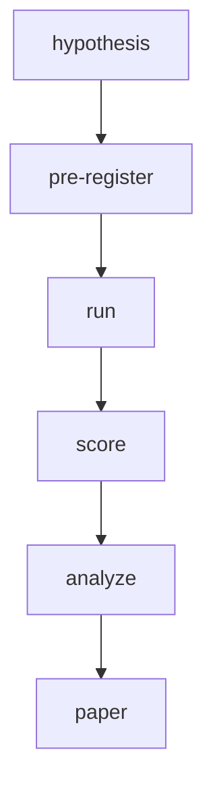

<p align="center">
  <a href="https://conventionalcommits.org"></a>
  <a href="https://github.com/clouatre-labs/x402-treasury-experiments/blob/main/LICENSE"></a>
  
</p>

<h1 align="center">x402 Treasury Experiments</h1>

What does it cost to turn L2 USDC micropayment revenue into spendable fiat? This repository
hosts pre-registered measurement experiments on the treasury side of the production site
[clouatre.ca](https://clouatre.ca), analogous in style to the sibling repositories
[webmcp-description-benchmarks](https://github.com/clouatre-labs/webmcp-description-benchmarks)
and [param-description-experiments](https://github.com/clouatre-labs/param-description-experiments).
Each experiment is committed before it runs: a protocol and operator runbook are fixed in git,
raw observations are collected verbatim into sessions, and the analyzed record validates against
the schema in [DATA_DICTIONARY.md](DATA_DICTIONARY.md) in CI.

## Lifecycle



## Experiment Index

| Slug | Question | Status | Key Result |
|------|----------|--------|------------|
| `usdc-fiat-sweep` | Retail Coinbase off-ramp cost (human-executed) | superseded pre-execution | n/a |
| `usdc-fiat-sweep-api` | Automated Advanced Trade off-ramp cost across $1-$100+ tranches | planned | TODO |

## Repository Layout

- `experiments/` - one directory per pre-registered experiment (see [experiments/README.md](experiments/README.md))
- `recipe/` - analysis notebooks and scripts that regenerate figures
- `figures/` - generated figures
- [METHODOLOGY.md](METHODOLOGY.md) - shared experimental design contract
- [DATA_DICTIONARY.md](DATA_DICTIONARY.md) - schema for `analysis.json` and run records
- [CITATION.cff](CITATION.cff) and `.zenodo.json` - citation metadata

## Reproduction

1. Clone the repository and check out the tag matching the release.
2. Install [uv](https://docs.astral.sh/uv/).
3. Validate the dataset schema:

   ```bash
   uv run python validate_schema.py
   ```

4. Regenerate figures from the recipes in `recipe/`.

Each experiment directory under `experiments/` contains its protocol, operator runbook, record-extraction instructions, raw sessions, and analysis records, so any result can be traced back to its pre-registered design.

## Citing This Work

See [CITATION.cff](CITATION.cff). A DOI will be added before first release.
