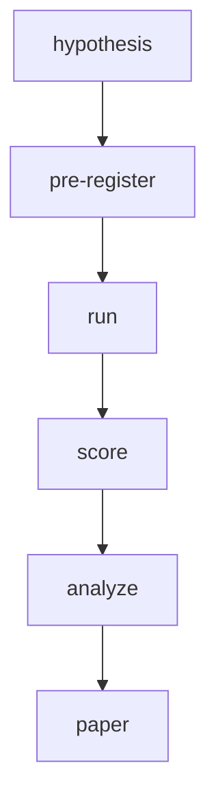
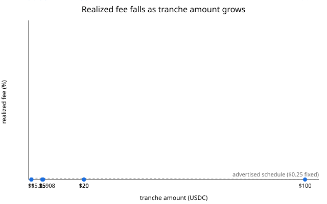
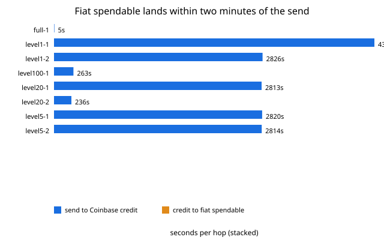

<p align="center">
  <a href="https://conventionalcommits.org"></a>
  <a href="https://github.com/clouatre-labs/x402-treasury-experiments/blob/main/LICENSE"></a>
  
</p>

<h1 align="center">x402 Treasury Experiments</h1>

What does it cost to turn L2 USDC micropayment revenue into spendable fiat? This repository
hosts pre-registered measurement experiments on the treasury side of the production site
[clouatre.ca](https://clouatre.ca), analogous in style to the sibling repositories
[webmcp-description-benchmarks](https://github.com/clouatre-labs/webmcp-description-benchmarks)
and [param-description-experiments](https://github.com/clouatre-labs/param-description-experiments).
Each experiment is committed before it runs: a protocol and operator runbook are fixed in git,
raw observations are collected verbatim into sessions, and the analyzed record validates against
the schema in [DATA_DICTIONARY.md](DATA_DICTIONARY.md) in CI.

## Lifecycle



## Experiment Index

| Slug | Question | Status | Key Result |
|------|----------|--------|------------|
| `usdc-fiat-sweep` | Retail Coinbase off-ramp cost (human-executed) | superseded pre-execution | n/a |
| `usdc-fiat-sweep-api` | Automated Advanced Trade off-ramp cost across $1-$100+ tranches | complete | realized fee 0.00% on every tranche ($1 to full balance); convert fee quoted and charged at $0.00; USD spread 0% |

## Repository Layout

- `experiments/` - one directory per pre-registered experiment (see [experiments/README.md](experiments/README.md))
- `recipe/` - analysis notebooks and scripts that regenerate figures
- `figures/` - generated figures
- [METHODOLOGY.md](METHODOLOGY.md) - shared experimental design contract
- [DATA_DICTIONARY.md](DATA_DICTIONARY.md) - schema for `analysis.json` and run records
- [CITATION.cff](CITATION.cff) and `.zenodo.json` - citation metadata

## Reproduction

1. Clone the repository and check out the tag matching the release.
2. Install [uv](https://docs.astral.sh/uv/).
3. Validate the dataset schema:

   ```bash
   uv run python validate_schema.py
   ```

4. Regenerate figures from the recipes in `recipe/`.

Each experiment directory under `experiments/` contains its protocol, operator runbook, record-extraction instructions, raw sessions, and analysis records, so any result can be traced back to its pre-registered design.

## Results

### usdc-fiat-sweep-api

**Status:** complete. **First published release:** [v1.0.1](https://github.com/clouatre-labs/x402-treasury-experiments/releases/tag/v1.0.1) (v1.0.0 was created by mistake against the wrong commit and deleted; GitHub permanently reserves the name, so v1.0.1 is the first published version).

Across all 8 executed tranches ($1, $1, $5, $5, $20, $20, $100, and the $5.25908 residual, totaling $157.25908 USDC converted via the Coinbase Advanced Trade convert API), the convert fee quoted and charged was $0.00, the realized fee was 0.00%, and the USD spread against the $1.00 USDC mid was 0%: each tranche converted 1:1 into fiat (`fiat_received` equals `amount_usdc` in every record). The only realized cost of the sweep was Base gas for the eight on-chain transfer legs, paid from the 0.00014 ETH float seeded at funding (approximately $0.31). The pre-registered ninth tranche (`full-2`) was recorded as `not_executed`: a single-balance wallet has no residual balance after `full-1` runs.

Realized fee per tranche, with the advertised fee schedule overlaid:



*Figure 1: Realized fee per executed tranche (all 0.00%), with the advertised Coinbase fixed-fee schedule as a percentage of tranche amount overlaid for reference.*

Time from on-chain send to fiat spendable:



*Figure 2: Send-to-spendable latency per executed tranche; clean data points are 3m56s (`level20-2`), 4m23s (`level100-1`), and 5s (`full-1`).*

Figure 3 (fee decomposition) is intentionally absent: every cost component is zero in the records, so there is nothing to decompose.

**Limitations.** (1) `timestamp_coinbase_credit`/`timestamp_fiat_spendable` for the first five tranches (`level1-1`, `level1-2`, `level20-1`, `level5-1`, `level5-2`) are recovery-time artifacts of the `level1-1` remediation (see [METHODOLOGY.md, Execution Deviations](METHODOLOGY.md#execution-deviations-recorded-per-protocol-stop-and-record)), not fill moments; latency findings rest on the three clean points in Figure 2. (2) The Figure 1 advertised-fee overlay uses the pre-execution `ADVERTISED_FIXED_FEE_USD` constant in `recipe/usdc_fiat_sweep_common.py`; the live Advanced Trade taker schedule was recorded verbatim in the raw artifacts, but the frozen recipe's overlay constant was not updated after execution. (3) This is a single-wallet, operator-executed measurement: timestamps come from the operator script rather than an independent observer, and no independent replication exists.

## Citing This Work

See [CITATION.cff](CITATION.cff). A DOI will be added before first release.
