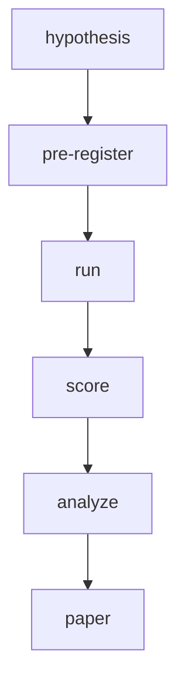
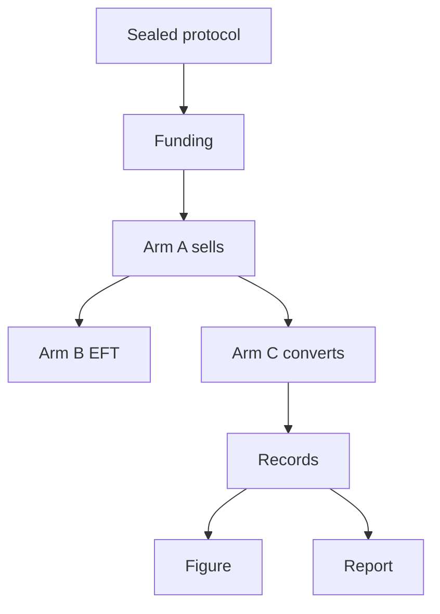
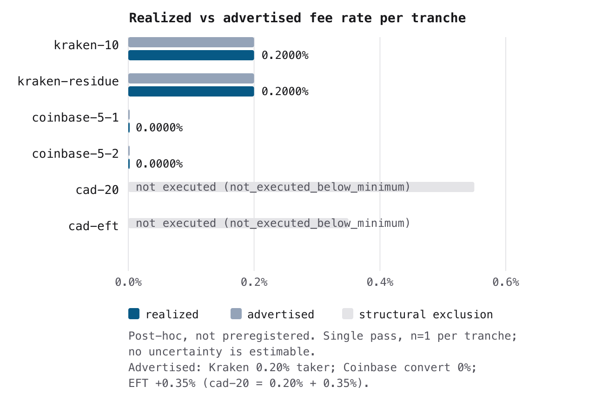
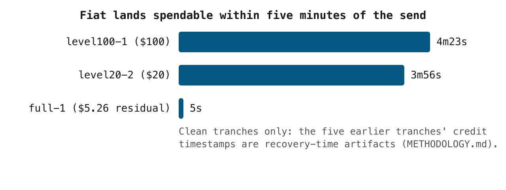

<p align="center">
  <a href="https://conventionalcommits.org"></a>
  <a href="https://github.com/clouatre-labs/x402-treasury-experiments/blob/main/LICENSE"></a>
  
  <a href="https://doi.org/10.5281/zenodo.23927458"></a>
</p>

<h1 align="center">x402 Treasury Experiments</h1>

What does it cost to turn L2 USDC micropayment revenue into spendable fiat? This repository
hosts pre-registered measurement experiments on the treasury side of the production site
[clouatre.ca](https://clouatre.ca), analogous in style to the sibling repositories
[webmcp-description-benchmarks](https://github.com/clouatre-labs/webmcp-description-benchmarks)
and [param-description-experiments](https://github.com/clouatre-labs/param-description-experiments).
Scope note: the completed experiment measures on-exchange conversion (the Coinbase USD
ledger), not bank settlement; costs downstream of the exchange (ACH/wire disbursement,
hold periods) are unmeasured and are a planned endpoint for the v2 experiment.
Each experiment is committed before it runs: a protocol and operator runbook are fixed in git,
raw observations are collected verbatim into sessions, and the analyzed record validates against
the schema in [DATA_DICTIONARY.md](DATA_DICTIONARY.md) in CI.

## Lifecycle



*Figure 1: Each experiment moves through a fixed lifecycle: the design is
pre-registered in git before anything runs, and every reported number traces
back to that sealed design.*

## Experiment Index

*Table 1: One row per pre-registered experiment; key results link to the full records.*

| Slug | Question | Status | Key Result |
|------|----------|--------|------------|
| `usdc-fiat-sweep` | Retail Coinbase off-ramp cost (human-executed) | superseded pre-execution | n/a |
| `usdc-fiat-sweep-api` | Coinbase Advanced Trade USDC/USD convert cost on Base across $1-$100+ tranches (issuer-redemption rail verification) | complete | realized fee 0.00% on every tranche ($1 to full balance); convert fee quoted and charged at $0.00; USD spread 0% |
| `usdc-fiat-sweep-v2` | Kraken independent-exchange micro-sweep (realized vs advertised), CAD EFT disbursement, and Coinbase continuity at x402 micro-receipt volumes | complete (one pass; Arm B recorded not_executed with cause) | realized fee exactly 0.20% advertised on both Kraken USD sells; Coinbase convert $0.00 fee 1:1 (continuity holds); CAD leg not executed: sealed residue formula consumes Arm B funding (see results) |

## Repository Layout

- `experiments/` - one directory per pre-registered experiment (see [experiments/README.md](experiments/README.md))
- `recipe/` - analysis notebooks and scripts that regenerate figures
- `figures/` - generated figures
- `results/` - written experiment reports with per-tranche records and reproduction commands
- [METHODOLOGY.md](METHODOLOGY.md) - shared experimental design contract
- [DATA_DICTIONARY.md](DATA_DICTIONARY.md) - schema for `analysis.json` and run records
- [CITATION.cff](CITATION.cff) and `.zenodo.json` - citation metadata

## Reproduction

1. Clone the repository and check out the tag matching the release.
2. Install [uv](https://docs.astral.sh/uv/).
3. Validate the dataset schema:

   ```bash
   uv run python validate_schema.py
   ```

4. Regenerate figures from the recipes in `recipe/`.

Each experiment directory under `experiments/` contains its protocol, operator runbook, record-extraction instructions, raw sessions, and analysis records, so any result can be traced back to its pre-registered design.

## Results

### usdc-fiat-sweep-v2

**Status:** complete (one execution pass, 2026-11-04; no tranche re-runs). Design sealed at commit `60ecd00` before execution; every deviation from the sealed script is recorded verbatim in [METHODOLOGY.md, Execution Deviations](METHODOLOGY.md#execution-deviations-recorded-per-protocol-stop-and-record). Full report: [results/usdc-fiat-sweep-v2.md](results/usdc-fiat-sweep-v2.md). Records: [experiments/usdc-fiat-sweep-v2/sessions/](experiments/usdc-fiat-sweep-v2/sessions/).

Headline: the independent exchange charged exactly its advertised rate and the issuer rail reproduced v1's zero-fee finding at x402 micro-receipt volumes; the CAD disbursement leg is a recorded negative result with a structural cause. Realized vs advertised per transaction:

*Table 2: Realized vs advertised cost per transaction, one execution pass. All numbers verbatim from committed records; fiat received equals amount minus fee (1:1 on Coinbase, 0.20% on Kraken); Kraken quote-context (fill price vs mid) was re-observed post-recovery and is flagged in the records and in Figure 3.*

| Tranche | Arm | Amount (USDC) | Realized fee | Advertised | `execution_status` |
| --- | --- | --- | --- | --- | --- |
| `kraken-10` | A | 10.0 | $0.019996 (0.2000%) | 0.20% taker | `clean_fill` (recovered) |
| `kraken-residue` | A | 91.0 | $0.181964 (0.2000%) | 0.20% taker | `clean_fill` (recovered) |
| `coinbase-5-1` | C | 10.0 | $0.00 (0%) | 0% | `clean_fill` (recovered; double commit) |
| `coinbase-5-2` | C | 5.0 | $0.00 (0%) | 0% | `clean_fill` (recovered) |
| `cad-20` | B | - | - | 0.20% + 0.35% | `not_executed_below_minimum` |
| `cad-eft` | B | - | - | 0.35% | `not_executed_below_minimum` |

Total realized exchange fees: $0.20196, within the pre-registered <$1 budget. The two Arm B rows are recorded outcomes, not missing data: the sealed residue formula sells the entire spendable USDC balance before the fixed-size cad-20 tranche, so the CAD measurement is arithmetically impossible for any working capital; pass 2 reserves the Arm B amount (or orders Arm B before the residue). All executed tranches are recovery-assisted (`is_latency_valid = false` throughout, per the mechanical exclusion rule), so this pass supports no latency claims; fee and price endpoints come verbatim from executed fills. `coinbase-5-1` converted double principal (two 1:1, $0.00 commits after a crash between commit and record write).

Against the protocol's four questions: **Q1** — the independent exchange (Kraken) charged exactly its advertised 0.20% taker fee on both executed USD sells, with the realized fill price 0.005% above the observed mid and realized slippage −0.01% (better than the quoted ask); no hidden spread is measurable at these volumes. **Q2** — unanswered with cause: the sealed tranche design cannot produce the CAD measurement (structural residue-formula inconsistency), recorded as outcomes, not repaired mid-pass. **Q3** — v1's zero-fee continuity holds: Coinbase convert committed 1:1 at $0.00 fee on both Arm C tranches. **Q4** — the gateway architecture is unmeasurable at this volume (one provider has no off-ramp product; the other's effective cost is off-scale), recorded as a selection-survey finding. Practitioner takeaway for x402-style treasury flows at $5–$20 per receipt: the issuer rail (Coinbase convert) is free but latency-unvalidated here, the independent exchange costs exactly its advertised 0.20%, and a same-pass CAD disbursement endpoint must be designed against the residue formula, not appended after it.

Pipeline of the sealed pass:



*Figure 2: The v2 execution pass. The sealed protocol (commit `60ecd00`) fixes the tranche ladder before funding; Arms A and C execute with verbatim raw artifacts, Arm B records its structural non-execution, and the figure and report derive only from the committed records.*



*Figure 3: Realized fee rate (dark blue) against the advertised schedule (grey) per tranche, on a common 0–0.6% rate axis. Every executed tranche's realized rate sits at its advertised rate: 0.2000% on both Kraken sells, 0.0000% on both Coinbase converts. The two Arm B rows are structural exclusions (light grey, annotated with the recorded status), not missing data. Post-hoc figure (not preregistered); single pass, n=1 per tranche, so no uncertainty is estimable. Quote context was re-observed post-recovery (record notes). Generated by `figures/usdc_fiat_sweep_v2_rate_comparison.py` from the committed records. Absolute-USD amounts per tranche are in Table 2; the frozen pre-registration recipe's SVG variant of this chart (`figures/usdc_fiat_sweep_v2_fig1_cost_per_transaction.svg`) is kept as a pipeline artifact but not embedded, following the v1 precedent.*

*Code Snippet 1: Commands to inspect the committed v2 records and raw artifacts.*

```bash
# Realized vs advertised fee for each tranche
jq '{tranche_id, amount_usdc, fixed_fee_usd, realized_fee_pct,
     execution_status, is_latency_valid}' experiments/usdc-fiat-sweep-v2/sessions/*.json

# Verbatim Kraken fill behind the kraken-10 record
jq '."OX6CYI-EUPXR-OWAK3C" | {vol_exec, cost, fee, price, trades}' \
  experiments/usdc-fiat-sweep-v2/sessions/raw/kraken-10/query-orders.json

# Coinbase convert commits (both 1:1, fee $0.00)
jq '.trade | {id, status, "total_fee": .total_fee.amount.value}' \
  experiments/usdc-fiat-sweep-v2/sessions/raw/coinbase-5-1/convert-fill.json

# On-chain transfer receipts for the Arm C hops
jq '{transactionHash, status, blockNumber, blockTimestamp}' \
  experiments/usdc-fiat-sweep-v2/sessions/raw/coinbase-5-1/tx-receipt.json

# The recorded structural cause for the CAD leg
jq -r '.notes' experiments/usdc-fiat-sweep-v2/sessions/cad-20.json
```

### usdc-fiat-sweep-api

**Status:** complete. **First published release:** [v1.0.1](https://github.com/clouatre-labs/x402-treasury-experiments/releases/tag/v1.0.1). Version history note: v1.0.0 (wrong commit) and v1.0.2 (superseded before its metadata aligned) were deleted, and GitHub permanently reserves those names, so the published releases are v1.0.1 and v1.0.3 onward.

Across all 8 executed tranches ($1, $1, $5, $5, $20, $20, $100, and the $5.25908 residual, totaling $157.25908 USDC converted via the Coinbase Advanced Trade convert API), the convert fee quoted and charged was $0.00, the realized fee was 0.00%, and the USD spread against the $1.00 USDC mid was 0%: each tranche converted 1:1 into fiat (`fiat_received` equals `amount_usdc` in every record). The only realized cost of the sweep was Base gas for the eight on-chain transfer legs: total gas spent was 0.00000654 ETH (summed from the committed transaction receipts), under 5% of the 0.00014 ETH float seeded at funding (approximately $0.31). The pre-registered ninth tranche (`full-2`) was recorded as `not_executed`: a single-balance wallet has no residual balance after `full-1` runs.

The full written report, per-tranche record table, and reproduction commands live in [results/usdc-fiat-sweep-api.md](results/usdc-fiat-sweep-api.md).

The per-tranche fee result is a constant: the convert fee quoted and charged was $0.00 and the realized fee was 0.00% on all 8 executed tranches, and [Table 1 in the results report](results/usdc-fiat-sweep-api.md) states this more precisely than a chart of zeros. The fee-vs-amount chart that the frozen recipe pipeline emits is kept as a pipeline artifact under `figures/` but is not embedded here. Time from on-chain send to fiat spendable (clean tranches only):



*Figure 4: Send-to-spendable latency for the three tranches whose credit timestamps are genuine fill moments: 4m23s (`level100-1`), 3m56s (`level20-2`), and 5s (`full-1`). The five earlier tranches are excluded because their credit timestamps are recovery-time artifacts of the `level1-1` remediation; see Limitations below.*

Also intentionally absent: the frozen recipe's fee-decomposition figure (every cost component is zero, so there is nothing to decompose) and the recipe's fee-vs-amount chart described above.

**Limitations.** (1) `timestamp_coinbase_credit`/`timestamp_fiat_spendable` for the first five tranches (`level1-1`, `level1-2`, `level20-1`, `level5-1`, `level5-2`) are recovery-time artifacts of the `level1-1` remediation (see [METHODOLOGY.md, Execution Deviations](METHODOLOGY.md#execution-deviations-recorded-per-protocol-stop-and-record)), not fill moments; latency findings rest on the three clean points in Figure 4. (2) The frozen recipe's fee-vs-amount chart overlays the pre-execution `ADVERTISED_FIXED_FEE_USD` constant in `recipe/usdc_fiat_sweep_common.py`; the live Advanced Trade taker schedule was recorded verbatim in the raw artifacts, but the frozen recipe's overlay constant was not updated after execution. (3) This is a single-wallet, operator-executed measurement: timestamps come from the operator script rather than an independent observer, and no independent replication exists.

## Software Versions

- Records and figures generated with Python 3.13 via [uv](https://docs.astral.sh/uv/) (standard-library-only scripts).
- Schema validation: `uv run python validate_schema.py` (repo-committed validator).
- Execution pass ran with the sealed `sweep.ts` under Node.js with viem and native `crypto.subtle`; the pass script itself is frozen at commit `60ecd00` (see [METHODOLOGY.md](METHODOLOGY.md) for the four verbatim-recorded crash remediations applied during the pass).

## Data Availability

- All raw observations are committed in-tree: `experiments/usdc-fiat-sweep-v2/sessions/` (records, `funding.json`, and `raw/` artifacts: verbatim Kraken `QueryOrders`/`QueryTrades`/`AddOrder` responses, Coinbase convert quote/trade/fill JSON, persisted Base transaction receipts, preserved crashed-attempt records).
- On-chain legs are independently verifiable on Base mainnet from the `tx_hash_in`/`funding_tx_hash` fields; Kraken fills are verifiable read-only via `QueryOrders` with the committed `order_txid` values.
- Dataset archived at Zenodo (concept DOI): [10.5281/zenodo.23927458](https://doi.org/10.5281/zenodo.23927458).

## Citing This Work

See [CITATION.cff](CITATION.cff) or:

```bibtex
@dataset{clouatre2026x402treasury,
  title  = {x402 Treasury Experiments},
  author = {Clouâtre, Hugues},
  year   = {2026},
  doi    = {10.5281/zenodo.23927458},
  note   = {All versions. Latest version DOI: \url{https://doi.org/10.5281/zenodo.23929259}}
}
```

Dataset archived at Zenodo (concept DOI): [10.5281/zenodo.23927458](https://doi.org/10.5281/zenodo.23927458); latest version: [10.5281/zenodo.23929259](https://doi.org/10.5281/zenodo.23929259). Companion post: [Agent payments and the x402 treasury](https://clouatre.ca/posts/agent-payments-x402/).
