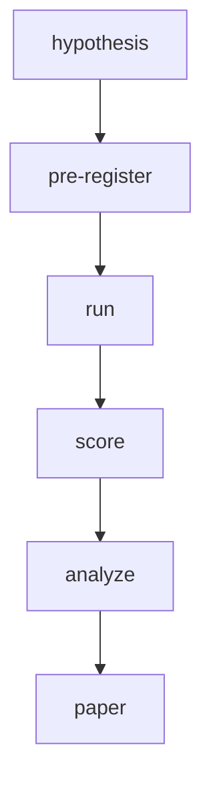

<p align="center">
  <a href="https://conventionalcommits.org"></a>
  <a href="https://github.com/clouatre-labs/x402-treasury-experiments/blob/main/LICENSE"></a>
  
  <a href="https://doi.org/10.5281/zenodo.23927458"></a>
</p>

<h1 align="center">x402 Treasury Experiments</h1>

What does it cost to turn L2 USDC micropayment revenue into spendable fiat? This repository
hosts pre-registered measurement experiments on the treasury side of the production site
[clouatre.ca](https://clouatre.ca), analogous in style to the sibling repositories
[webmcp-description-benchmarks](https://github.com/clouatre-labs/webmcp-description-benchmarks)
and [param-description-experiments](https://github.com/clouatre-labs/param-description-experiments).
Scope note: the completed experiment measures on-exchange conversion (the Coinbase USD
ledger), not bank settlement; costs downstream of the exchange (ACH/wire disbursement,
hold periods) are unmeasured and are a planned endpoint for the v2 experiment.
Each experiment is committed before it runs: a protocol and operator runbook are fixed in git,
raw observations are collected verbatim into sessions, and the analyzed record validates against
the schema in [DATA_DICTIONARY.md](DATA_DICTIONARY.md) in CI.

## Lifecycle



*Figure 1: Each experiment moves through a fixed lifecycle: the design is
pre-registered in git before anything runs, and every reported number traces
back to that sealed design.*

## Experiment Index

*Table 1: One row per pre-registered experiment; key results link to the full records.*

| Slug | Question | Status | Key Result |
|------|----------|--------|------------|
| `usdc-fiat-sweep` | Retail Coinbase off-ramp cost (human-executed) | superseded pre-execution | n/a |
| `usdc-fiat-sweep-api` | Coinbase Advanced Trade USDC/USD convert cost on Base across $1-$100+ tranches (issuer-redemption rail verification) | complete | realized fee 0.00% on every tranche ($1 to full balance); convert fee quoted and charged at $0.00; USD spread 0% |
| `usdc-fiat-sweep-v2` | Kraken independent-exchange micro-sweep (realized vs advertised), CAD EFT disbursement, and Coinbase continuity at x402 micro-receipt volumes | complete (one pass; Arm B recorded not_executed with cause) | realized fee exactly 0.20% advertised on both Kraken USD sells; Coinbase convert $0.00 fee 1:1 (continuity holds); CAD leg not executed: sealed residue formula consumes Arm B funding (see results) |

## Repository Layout

- `experiments/` - one directory per pre-registered experiment (see [experiments/README.md](experiments/README.md))
- `recipe/` - analysis notebooks and scripts that regenerate figures
- `figures/` - generated figures
- `results/` - written experiment reports with per-tranche records and reproduction commands
- [METHODOLOGY.md](METHODOLOGY.md) - shared experimental design contract
- [DATA_DICTIONARY.md](DATA_DICTIONARY.md) - schema for `analysis.json` and run records
- [CITATION.cff](CITATION.cff) and `.zenodo.json` - citation metadata

## Reproduction

1. Clone the repository and check out the tag matching the release.
2. Install [uv](https://docs.astral.sh/uv/).
3. Validate the dataset schema:

   ```bash
   uv run python validate_schema.py
   ```

4. Regenerate figures from the recipes in `recipe/`.

Each experiment directory under `experiments/` contains its protocol, operator runbook, record-extraction instructions, raw sessions, and analysis records, so any result can be traced back to its pre-registered design.

## Results

### usdc-fiat-sweep-api

**Status:** complete. **First published release:** [v1.0.1](https://github.com/clouatre-labs/x402-treasury-experiments/releases/tag/v1.0.1). Version history note: v1.0.0 (wrong commit) and v1.0.2 (superseded before its metadata aligned) were deleted, and GitHub permanently reserves those names, so the published releases are v1.0.1 and v1.0.3 onward.

Across all 8 executed tranches ($1, $1, $5, $5, $20, $20, $100, and the $5.25908 residual, totaling $157.25908 USDC converted via the Coinbase Advanced Trade convert API), the convert fee quoted and charged was $0.00, the realized fee was 0.00%, and the USD spread against the $1.00 USDC mid was 0%: each tranche converted 1:1 into fiat (`fiat_received` equals `amount_usdc` in every record). The only realized cost of the sweep was Base gas for the eight on-chain transfer legs: total gas spent was 0.00000654 ETH (summed from the committed transaction receipts), under 5% of the 0.00014 ETH float seeded at funding (approximately $0.31). The pre-registered ninth tranche (`full-2`) was recorded as `not_executed`: a single-balance wallet has no residual balance after `full-1` runs.

The full written report, per-tranche record table, and reproduction commands live in [results/usdc-fiat-sweep-api.md](results/usdc-fiat-sweep-api.md).

The per-tranche fee result is a constant: the convert fee quoted and charged was $0.00 and the realized fee was 0.00% on all 8 executed tranches, and [Table 1 in the results report](results/usdc-fiat-sweep-api.md) states this more precisely than a chart of zeros. The fee-vs-amount chart that the frozen recipe pipeline emits is kept as a pipeline artifact under `figures/` but is not embedded here. Time from on-chain send to fiat spendable (clean tranches only):


*Figure 2: Send-to-spendable latency for the three tranches whose credit timestamps are genuine fill moments: 4m23s (`level100-1`), 3m56s (`level20-2`), and 5s (`full-1`). The five earlier tranches are excluded because their credit timestamps are recovery-time artifacts of the `level1-1` remediation; see Limitations below.*

Also intentionally absent: the frozen recipe's fee-decomposition figure (every cost component is zero, so there is nothing to decompose) and the recipe's fee-vs-amount chart described above.

**Limitations.** (1) `timestamp_coinbase_credit`/`timestamp_fiat_spendable` for the first five tranches (`level1-1`, `level1-2`, `level20-1`, `level5-1`, `level5-2`) are recovery-time artifacts of the `level1-1` remediation (see [METHODOLOGY.md, Execution Deviations](METHODOLOGY.md#execution-deviations-recorded-per-protocol-stop-and-record)), not fill moments; latency findings rest on the three clean points in Figure 2. (2) The frozen recipe's fee-vs-amount chart overlays the pre-execution `ADVERTISED_FIXED_FEE_USD` constant in `recipe/usdc_fiat_sweep_common.py`; the live Advanced Trade taker schedule was recorded verbatim in the raw artifacts, but the frozen recipe's overlay constant was not updated after execution. (3) This is a single-wallet, operator-executed measurement: timestamps come from the operator script rather than an independent observer, and no independent replication exists.

## Citing This Work

See [CITATION.cff](CITATION.cff) or:

```bibtex
@dataset{clouatre2026x402treasury,
  title  = {x402 Treasury Experiments},
  author = {Clouâtre, Hugues},
  year   = {2026},
  doi    = {10.5281/zenodo.23927458},
  note   = {All versions. Latest version DOI: \url{https://doi.org/10.5281/zenodo.23929259}}
}
```

Dataset archived at Zenodo (concept DOI): [10.5281/zenodo.23927458](https://doi.org/10.5281/zenodo.23927458); latest version: [10.5281/zenodo.23929259](https://doi.org/10.5281/zenodo.23929259). Companion post: [Agent payments and the x402 treasury](https://clouatre.ca/posts/agent-payments-x402/).
