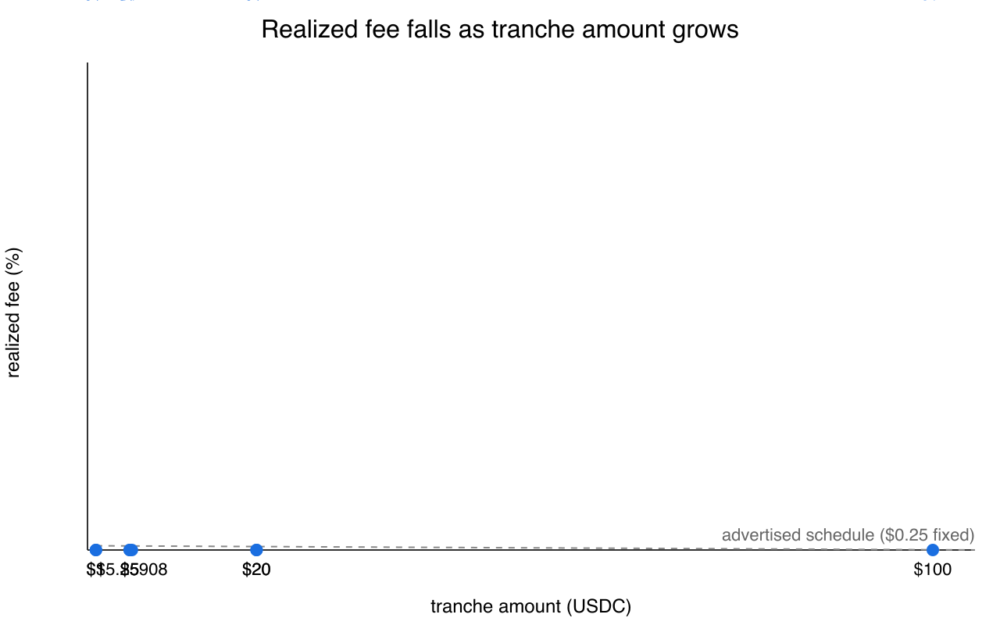
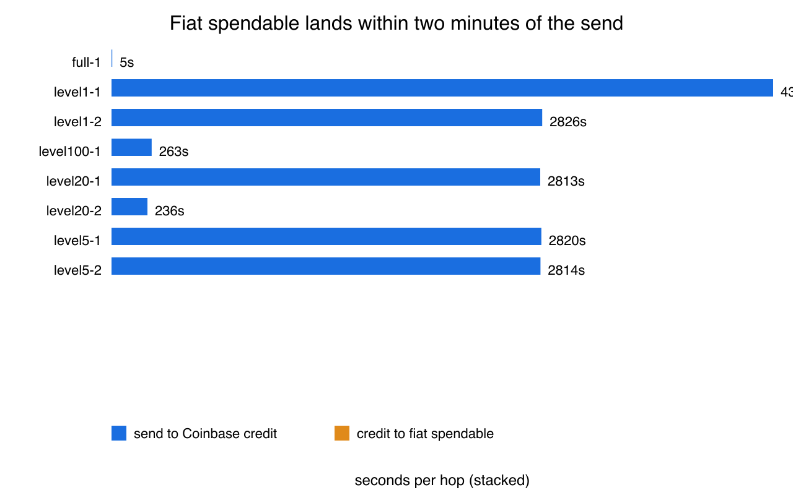

# Results: usdc-fiat-sweep-api

Status: complete. First published release:
[v1.0.1](https://github.com/clouatre-labs/x402-treasury-experiments/releases/tag/v1.0.1).
Version history note: v1.0.0 (wrong commit) and v1.0.2 (superseded before
its metadata aligned) were deleted, and GitHub permanently reserves those
names, so the published releases are v1.0.1 and v1.0.3 onward.
Design: [`experiments/usdc-fiat-sweep-api/protocol.md`](../experiments/usdc-fiat-sweep-api/protocol.md)
(sealed before execution). Records:
[`experiments/usdc-fiat-sweep-api/sessions/`](../experiments/usdc-fiat-sweep-api/sessions/).

## Headline result

Across all 8 executed tranches totaling $157.25908 USDC converted to USD via
the Coinbase Advanced Trade convert API, the convert fee quoted and charged
was $0.00, the realized fee was 0.00%, and the USD spread against the $1.00
USDC mid was 0%: each tranche converted 1:1 into fiat (`fiat_received` equals
`amount_usdc` in every record). The only realized cost of the sweep was Base
gas for the eight on-chain transfer legs, paid from the 0.00014 ETH float
seeded at funding (approximately $0.31). The pre-registered ninth tranche
(`full-2`) was recorded as `not_executed`: a single-balance wallet has no
residual balance after `full-1` runs.

## Per-tranche record

*Table 1: Executed tranches with amounts, quoted/realized fee, and spread, exactly as committed in the run records.*

| Tranche | Amount (USDC) | Fiat received (USD) | Quoted fee | Realized fee | Spread vs mid | Send to credit |
|---------|---------------|---------------------|------------|--------------|---------------|----------------|
| `level1-1` | 1 | 1 | $0.00 | 0.00% | 0% | recovery artifact |
| `level1-2` | 1 | 1 | $0.00 | 0.00% | 0% | recovery artifact |
| `level5-1` | 5 | 5 | $0.00 | 0.00% | 0% | recovery artifact |
| `level5-2` | 5 | 5 | $0.00 | 0.00% | 0% | recovery artifact |
| `level20-1` | 20 | 20 | $0.00 | 0.00% | 0% | recovery artifact |
| `level20-2` | 20 | 20 | $0.00 | 0.00% | 0% | 3m56s |
| `level100-1` | 100 | 100 | $0.00 | 0.00% | 0% | 4m23s |
| `full-1` | 5.25908 | 5.25908 | $0.00 | 0.00% | 0% | 5s |
| **Total** | **157.25908** | **157.25908** | **$0.00** | **0.00%** | **0%** | — |

Realized fee per tranche, with the advertised fee schedule overlaid:



*Figure 1: Realized fee per executed tranche (all 0.00%), with the advertised
Coinbase fixed-fee schedule as a percentage of tranche amount overlaid for
reference. The two smallest-tranche tick labels ($5, $5.25908) overlap at the
left edge; this is a rendering artifact of the frozen recipe, not missing
data.*

Time from on-chain send to fiat spendable:



*Figure 2: Send-to-spendable latency per executed tranche; clean data points
are 3m56s (`level20-2`), 4m23s (`level100-1`), and 5s (`full-1`). The bars
for the first five tranches (47-72 minutes) are recovery-time artifacts of
the `level1-1` remediation, not fill latency, and the `level1-1` value label
clips at the right edge; see Limitations.*

Figure 3 (fee decomposition) is intentionally absent: every cost component is
zero in the records, so there is nothing to decompose (see
[METHODOLOGY.md, Execution Deviations](../METHODOLOGY.md#execution-deviations-recorded-per-protocol-stop-and-record)).

## Latency

Clean send-to-spendable data points exist for the last three executed
tranches: 3m56s (`level20-2`), 4m23s (`level100-1`), and 5s (`full-1`). The
`timestamp_coinbase_credit`/`timestamp_fiat_spendable` values of the first
five tranches are recovery-time artifacts of the `level1-1` remediation, not
fill moments, and must not be read as latency findings (see Limitations).

## Limitations

1. Recovery-time timestamps: `timestamp_coinbase_credit` and
   `timestamp_fiat_spendable` for `level1-1`, `level1-2`, `level20-1`,
   `level5-1`, and `level5-2` are the times at which the records were
   recovered after the `level1-1` crash remediation (all cluster within one
   minute around 16:23 UTC), not the moments the converts filled. Latency
   findings rest on the three clean points above. Every deviation is recorded
   verbatim in
   [METHODOLOGY.md](../METHODOLOGY.md#execution-deviations-recorded-per-protocol-stop-and-record).
2. Stale overlay constant: the Figure 1 advertised-fee overlay uses the
   pre-execution `ADVERTISED_FIXED_FEE_USD = 0.25` constant in
   `recipe/usdc_fiat_sweep_common.py` (recipe scripts are frozen
   post-execution). The advertised fee recorded verbatim from the live
   convert quote API at execution time is $0.00, which equals the realized
   fee on every tranche.
3. Observer limitation: this is a single-wallet, operator-executed
   measurement. Timestamps come from the operator script rather than an
   independent observer, and no independent replication exists.

## Reproduce

```bash
# validate all records against the schema
uv run python validate_schema.py --sweep

# regenerate both figures byte-identically from the committed records.
# The frozen recipe loaders read every *.json in the record directory, so
# funding.json (which has no tranche amount) must be excluded:
mkdir -p /tmp/tranche-records
cp experiments/usdc-fiat-sweep-api/sessions/full-*.json \
   experiments/usdc-fiat-sweep-api/sessions/level*.json /tmp/tranche-records/
uv run python recipe/usdc_fiat_sweep_fig1_fee_vs_amount.py \
  --records /tmp/tranche-records
uv run python recipe/usdc_fiat_sweep_fig2_hop_latency.py \
  --records /tmp/tranche-records

# inspect the headline numbers
jq -s '[.[] | select(.executed == true)] |
  {tranches: length, total_usdc: (map(.amount_usdc) | add),
   max_realized_fee_pct: (map(.realized_fee_pct) | max)}' \
  experiments/usdc-fiat-sweep-api/sessions/*.json
```

The `jq` summary returns 8 tranches, total 157.25908 (floating-point
representation 157.25907999999998), max realized fee 0. On-chain measurements
cannot be re-run (single pre-registered pass, no re-runs); the figures and
summary statistics regenerate deterministically from the committed session
records.

The canonical figure format is SVG, written by the frozen recipes; the PNG
files embedded above are presentation renders of those SVGs (white
background for dark-theme legibility) and regenerate deterministically
alongside:

```bash
rsvg-convert -z 2 -b '#ffffff' \
  -o figures/usdc_fiat_sweep_fig1_fee_vs_amount.png \
  figures/usdc_fiat_sweep_fig1_fee_vs_amount.svg
rsvg-convert -z 2 -b '#ffffff' \
  -o figures/usdc_fiat_sweep_fig2_hop_latency.png \
  figures/usdc_fiat_sweep_fig2_hop_latency.svg
```

## Cite

See [CITATION.cff](../CITATION.cff). Dataset archived at Zenodo:
[10.5281/zenodo.23927459](https://doi.org/10.5281/zenodo.23927459)
(all versions: [10.5281/zenodo.23927458](https://doi.org/10.5281/zenodo.23927458)).
