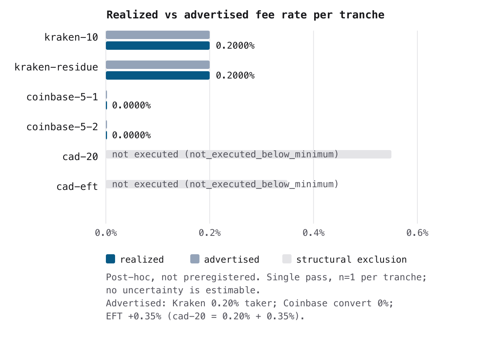

# Results: usdc-fiat-sweep-v2

Status: complete. Execution pass finished (one pass, ascending tranche
order, no tranche re-runs; recovery deviations recorded verbatim in
[METHODOLOGY.md](../METHODOLOGY.md#execution-deviations-recorded-per-protocol-stop-and-record)).
Design:
[`experiments/usdc-fiat-sweep-v2/protocol.md`](../experiments/usdc-fiat-sweep-v2/protocol.md)
(sealed at commit `60ecd00` before execution). Records:
[`experiments/usdc-fiat-sweep-v2/sessions/`](../experiments/usdc-fiat-sweep-v2/sessions/).

## Headline result

At x402 micro-receipt volumes ($5-$20 per transaction), the independent
exchange (Kraken, order book USDC/USD, stablecoin fee schedule) charged
**exactly its advertised 0.20% taker fee on both executed USD sell tranches**
($10 and $91 residue), with no measurable hidden spread: the realized fill
price sat 0.005% above the observed order-book mid, and realized slippage
against top-of-book was −0.01% (better than the quoted ask, at micro sizes
where the fixed 5 USDC `ordermin` dominates). The issuer rail (Coinbase
Advanced Trade convert) reproduced v1's continuity finding: **quoted and
realized convert fee $0.00, 1:1 USDC/USD** on both Arm C commits, so Q1 and
Q3 are answered cleanly. **Q2 (CAD disbursement) is answered negatively with
cause**: the sealed tranche design is arithmetically incapable of producing
the Arm B measurement — the residue-sweep formula sells the entire spendable
USDC balance before the fixed-size cad-20 tranche can run, for any working
capital — so cad-20 and cad-eft are recorded as
`not_executed_below_minimum` outcomes, not missing data. This design finding
(pass-2: reserve the Arm B amount in the residue formula, or order Arm B
before the residue) is arguably the most reproducible result of the pass.

Execution reliability caveat: the sealed `sweep.ts` contained four latent
defects that crashed the pass mid-flight and required verbatim-recorded,
measurement-preserving recovery (QueryTrades order-id misuse; missing
`trades` field on QueryOrders; convert quote payload field drift
`from_amount` → v1-proven `amount`; `total_fee` shape drift), plus one
double convert commit on `coinbase-5-1` (both commits 1:1 at $0.00 fee).
Per the mechanical exclusion rule, all recovered tranches carry
`is_latency_valid = false`; only latency-descriptive claims from
non-recovered hops would be valid, and the pass produced none (every
executed tranche was recovery-assisted). Fee and price endpoints are
unaffected: they come verbatim from executed fills.

## Per-transaction table (USD legs; all numbers verbatim from committed records)

*Table 1: Realized vs advertised cost, usdc-fiat-sweep-v2, one execution pass 2026-11-04.*

| Tranche | Arm | Amount (USDC) | Fiat received (USD) | Avg fill price | Realized fee | Advertised | Realized fee % | Spread vs mid | `execution_status` |
|---|---|---|---|---|---|---|---|---|---|
| `kraken-10` | A | 10.0 | 9.998 | 0.9998 | $0.019996 | 0.20% taker | 0.2000% | +0.0050% | `clean_fill` (recovered) |
| `kraken-residue` | A | 91.0 | 90.9818 | 0.9998 | $0.181964 | 0.20% taker | 0.2000% | +0.0050% | `clean_fill` (recovered) |
| `coinbase-5-1` | C | 10.0* | 10.0 | 1.00 (rate 1.0) | $0.00 | 0% | 0.0000% | 0% | `clean_fill` (recovered; double commit) |
| `coinbase-5-2` | C | 5.0 | 5.0 | 1.00 (rate 1.0) | $0.00 | 0% | 0.0000% | 0% | `clean_fill` (recovered) |

\* `coinbase-5-1` converted 10 USDC instead of 5: the convert committed twice
(trades `2cbbb2ce...` and `9cd251ae...`, both 1:1 at $0.00) because the
crashed attempt's commit was followed by a resume with no idempotency token.
Fee endpoints are unaffected; the duplicated principal is a working-capital
placement effect, recorded verbatim in the record notes.

Not executed (recorded outcomes):



*Figure 2: Realized fee rate (dark blue) against the advertised schedule (grey) per tranche, on a common 0–0.6% rate axis. Every executed tranche's realized rate sits at its advertised rate; the two Arm B rows are structural exclusions (light grey, annotated with the recorded status), not missing data. Post-hoc figure (not preregistered); single pass, n=1 per tranche, so no uncertainty is estimable. Quote context was re-observed post-recovery (record notes). Generated by `figures/usdc_fiat_sweep_v2_rate_comparison.py` from the committed records.*

| Tranche | Arm | Status | Verbatim cause |
|---|---|---|---|
| `cad-20` | B | `not_executed_below_minimum` | insufficient balance: sealed residue formula consumed spendable USDC before Arm B (kraken-10 sold 10 of 101; residue sold all 91); Kraken USDC balance 0 at tranche time |
| `cad-eft` | B | `not_executed_below_minimum` | not_executed: upstream cad-20 convert did not execute, so no CAD proceeds exist to withdraw via EFT (Pateno) |

## CAD leg (reported separately, never averaged into USD)

The CAD leg produced **no measurements**. Arm B was designed to sell 20 USDC
into CAD on the Kraken order book (USDC/CAD mid observed at 1.3961-1.3972
during preflight on 2026-11-04) and disburse via EFT (Pateno; advertised
0.00 CAD + 0.35%). Both tranches are recorded outcomes with the structural
cause above; there are no CAD fee, spread, deduction, or arrival numbers to
report, and none are synthesized. Q2 remains open for a pass-2 protocol with
the corrected residue formula.

## Gateway survey (Q4, recorded finding)

Verbatim from the sealed protocol (quotes observed 2026-11-03):

| Provider | Offer for $10 USDC sell | Disqualification reason |
|---|---|---|
| Dexter | none — no operator fiat off-ramp exists in the product (facilitator/wallet infrastructure only) | no fiat disbursement capability |
| Transak | 10 USDC -> 5.86 USD via card payout on Ethereum mainnet only (~41% effective cost at $10, quote observed in vendor widget) | Ethereum-only sell rail (no Base), card payout not bank deposit, effective cost off-scale |

The gateway architecture remains unmeasurable at this volume: one provider
has no off-ramp product, the other is an order of magnitude off-scale. The
measured comparison therefore stands as independent exchange (Kraken) vs
issuer rail (Coinbase).

## Limitations

- **Micro-volume scope.** Claims restricted per the sealed claim scope:
  programmatic micro-receipt off-ramps at $5-$20 scale for automated
  agent/API workflows; not institutional volumes, order-book depth, tier
  boundaries, or fiat off-ramp cost in general.
- **Single operator, single wallet.** Operator-executed measurement with
  operator-script timestamps; results describe the measured providers and
  rails at these volumes and do not generalize to other networks, providers,
  or volume tiers.
- **Recovery-assisted pass.** Every executed tranche required recovery after
  a mid-pass crash (`is_latency_valid = false` throughout); Arm C quote
  observations were re-taken post-recovery, and `kraken-10` /
  `kraken-residue` quote context (`pair_mid`, `quoted_price`,
  `realized_slippage`, `spread_vs_mid_pct`) was observed after the crash,
  not at order placement, as flagged in the record notes. Fee and fill
  endpoints are verbatim from executed fills.
- **Arm C double commit.** `coinbase-5-1` converted double principal (both
  commits at $0.00, rate 1.0), so its row reports 10 USDC, not the planned 5.
- **Q2 unanswered-with-cause.** The sealed design cannot produce the CAD
  measurement (residue-formula inconsistency); recorded, not repaired
  mid-pass. Pass 2 with the corrected formula can answer it.
- **EFT arrival pending** — not applicable: the EFT never executed, so there
  is no pending bank arrival to track.
- **Real cost within budget.** Total realized exchange fees: $0.20196 USD
  (both Kraken sells) + $0.00 (Coinbase) = $0.20196, within the <$1
  pre-registered budget. Base gas for funding and the two Arm C transfers is
  a working-capital cost excluded from sweep endpoints per the sealed design.

## Reproduction

```
uv run python validate_schema.py
uv run python recipe/usdc_fiat_sweep_v2_fig1_cost.py --records <dir-with-6-records-only>
uv run python figures/usdc_fiat_sweep_v2_rate_comparison.py
uv run python figures/usdc_fiat_sweep_v2_cost_per_tx.py
```

The `--records` indirection is required because the sealed recipe's loader
does not filter `funding.json` from the sessions directory (recorded
deviation). The two `figures/` scripts are post-hoc (added after the sealed
pass, following the `usdc_fiat_sweep_hop_latency_clean.py` precedent): they
read only the committed records plus the pre-registered advertised schedule
constants from `protocol.md`; the frozen pre-registration recipe set
contains fig1 only. Both render styled SVG plus a white-background PNG
(`rsvg-convert -z 2 -b #ffffff`); the PNG is what the docs embed, since
directly embedded transparent SVGs are unreadable on GitHub dark mode.
